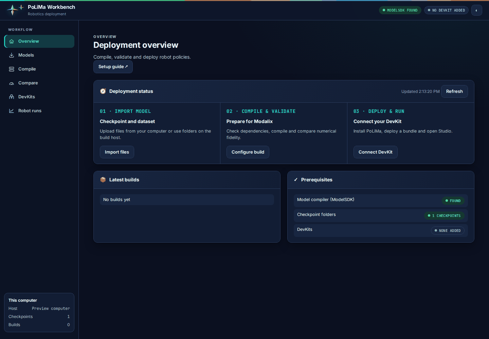
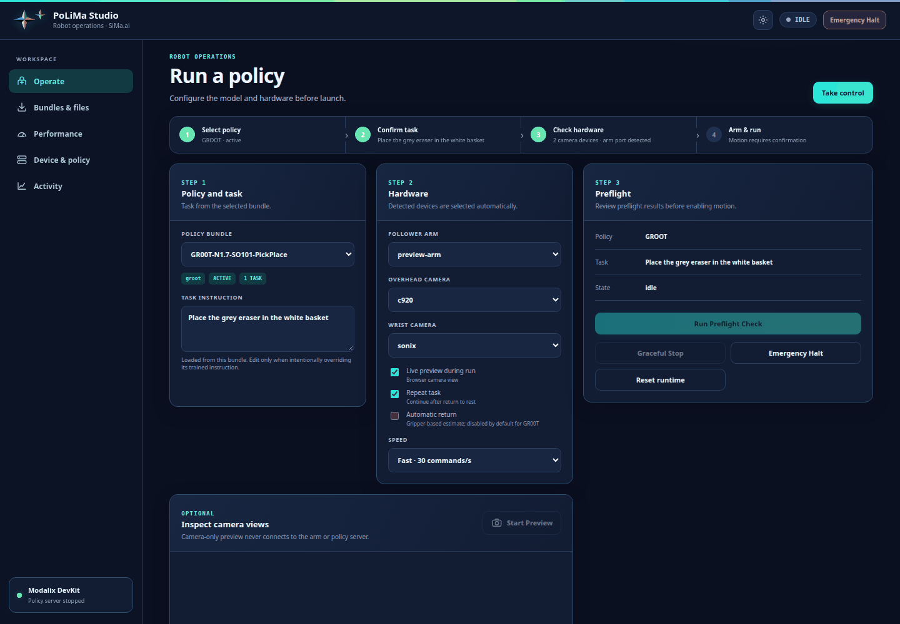

# PoLiMa

**Po**licy + Si**Ma**: compile robot policies (ACT, NVIDIA GR00T) for the SiMa.ai
Modalix DevKit and drive a robot arm with them.

```
checkpoint ──compile──▶ bundle ──deploy──▶ DevKit ──robot run──▶ SO-101 arm
 (your PC)              (folder)           (Modalix)
```

PoLiMa is the robot counterpart of [LLiMa](https://github.com/sima-neat/llima).
It does not train models: train with LeRobot or NVIDIA's GR00T code as usual,
and PoLiMa starts from the checkpoint.

| Model | Compile on Linux | Run on the DevKit | Tested on an SO-101 arm |
|---|---|---|---|
| ACT (LeRobot) | yes | yes | yes |
| GR00T N1.6 | yes | yes | yes (mixed precision) |
| GR00T N1.7 | yes | yes | yes (mixed precision) |

## Start here

- **Set up an SO-101.** Equipment and deployment workflow: [examples/so101](examples/so101/README.md).
- **Run your own model.** Record, train, compile, check and run:
  [docs/your-own-model.md](docs/your-own-model.md).

Start with [installation](docs/install.md), including host prerequisites,
DevKit installation and access from a laptop to a remote compiler host.
After installation, run `polima workbench start` and open its printed URL.

## Compiled models

Download the SO-101 pick-and-place bundles from Hugging Face:
[GR00T N1.6](https://huggingface.co/simaai/GR00T-N1.6-SO101-PickPlace) and
[GR00T N1.7](https://huggingface.co/simaai/GR00T-N1.7-SO101-PickPlace). Both produce 32 actions per plan.
Follow the [download and setup instructions](examples/so101/README.md#2-download-and-deploy-the-bundle).
If repository access is restricted, sign in with an authorized Hugging Face account.

## Reference robot setup


The SO-101 pick-and-place setup. Follow the
[hardware, measurements and camera-view guide](examples/so101/README.md#reference-placement)
to reproduce the arrangement.

## Workbench and Studio

**Workbench** runs on the build host: import a checkpoint and dataset, configure
compilation, and deploy the resulting bundle to a DevKit.



**Studio** runs on the DevKit: select a policy, configure hardware, manage the
runtime and benchmark inference before running the arm.



These navigation previews use example data; they do not show a hardware run or
measured performance. See the [SO-101 setup guide](examples/so101/README.md) for
the reference hardware, dataset, camera placement and calibration instructions.

## Commands

On your computer:

| Command | What it does |
|---|---|
| `polima compile` | Turns a checkpoint into a bundle: the compiled model, its settings and the robot client. |
| `polima deploy` | Copies a bundle to the DevKit and makes it the active one. |
| `polima run --fixture` | Checks a deployed bundle's answers and speed, without the arm. |
| `polima workbench start` | Web page for your checkpoints, bundles and DevKits ([README](src/polima/workbench/README.md)). |
| `polima doctor` | Checks this computer, the compiler and the DevKit. |

On the DevKit:

| Command | What it does |
|---|---|
| `polima robot calibrate` | Calibrates the arm once. |
| `polima robot run` | Drives the arm with the active bundle. Ctrl-C stops and returns the arm to rest. |
| `polima studio start` | Web page to install bundles, watch the cameras and run the arm ([README](src/polima/studio/README.md)). |
| `polima server start / stop / status` | The model server. |

Every command has `--help`.

## Performance

Reference measurements on a Modalix DevKit, mixed precision, one 32-move plan:

| Model | Model time on the DevKit | Camera picture to plan |
|---|---|---|
| GR00T N1.6 | 317 ms | 364 ms |
| GR00T N1.7 | 233 ms | 285 ms |

These measurements describe the reference setup, not a guaranteed latency for
every checkpoint or release bundle. Use the model card for artifact-specific
validation and benchmark your deployed bundle in Studio.

The arm keeps moving while the next plan is computed.

## Repository

| Folder | Contents |
|---|---|
| `src/polima/` | The `polima` command: compile, deploy, robot client, Studio, Workbench. |
| `runtime/` | The C++ model server that runs on the DevKit ([README](runtime/README.md)). |
| `examples/so101/` | Our SO-101 setup, and arm and teleoperation tools. |
| `docs/` | Reference guides: [install](docs/install.md), [your own model](docs/your-own-model.md), [GR00T](docs/groot.md), [deploy](docs/deploy.md), [robot](docs/robot.md). |

## Licence

PoLiMa's code is licensed under Apache-2.0. Bundled UI component notices are
included in [LICENSE](LICENSE). GR00T bundles remain subject to NVIDIA’s model
licence, including the non-commercial research/evaluation restriction in the
source checkpoint licences. See [third-party licences](THIRD_PARTY.md) and the
licence supplied with each model package.
