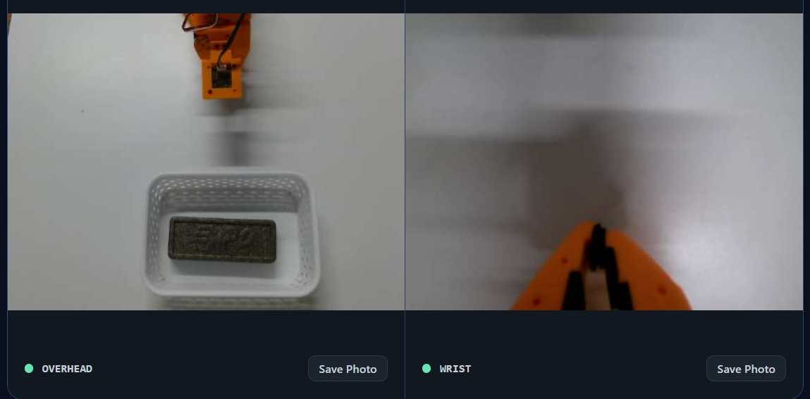
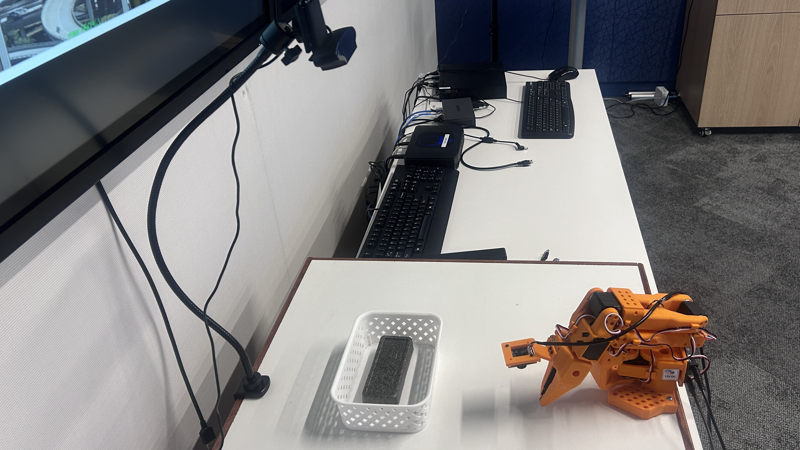
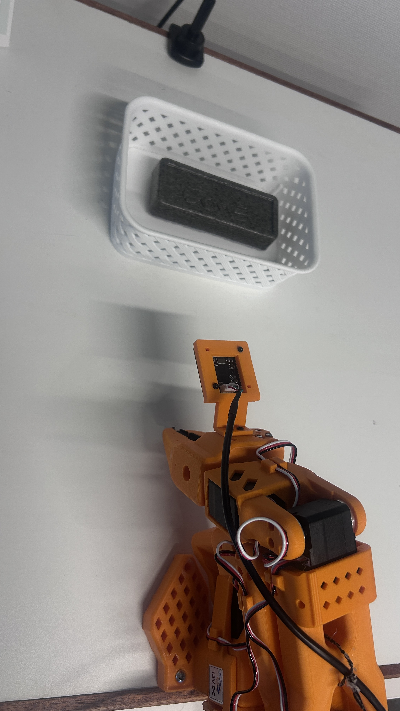

# GR00T on SO-101

Deploy a compiled GR00T N1.6 or N1.7 policy to Modalix, verify inference, then
run an SO-101 follower arm. The reference task is placing a grey eraser in a
white basket. A model trained for this task is not a general-purpose robot policy.

## Before you start

| Item | Requirement |
|---|---|
| Model | A compiled PoLiMa bundle for SO-101, with its model card, licence and validation results. |
| DevKit | Modalix with a supported SDK and NVMe storage; see [installation](../../docs/install.md). |
| Robot | Assembled SO-101 follower with five arm joints and one gripper using the supported Feetech STS3215 motor configuration (IDs 1–6). A leader arm is not needed for inference. |
| Power and mounting | Power supply matched to the installed motor voltage; securely mounted robot base and camera mounts. |
| Connections | Follower USB serial connection and two USB RGB cameras connected to the DevKit; secure the cables throughout the arm workspace. |
| Cameras | Logitech C920 overhead and the reference Sonix USB wrist camera described below, capturing 640 × 480 at 30 frames/s. |
| Host | PoLiMa deployment installation, SSH and rsync; Linux/macOS or Windows through WSL. |

A precompiled bundle does not require the training dataset, PyTorch checkpoint
or ModelSDK on the customer's host. To compile your own checkpoint, use the
[compiler guide](../../docs/your-own-model.md#gr00t) first.

## Reference models

These are task-specific SO-101 fine-tunes for placing a grey eraser in a white
basket. Both deployment bundles use checkpoint step 50,000, 32 output actions and mixed
precision. N1.7 was trained with a native 40-step architecture and supervised
32-step targets; the released bundle exposes 32 actions.

| Model | Compiled model repository |
|---|---|
| GR00T N1.6 | [simaai/GR00T-N1.6-SO101-PickPlace](https://huggingface.co/simaai/GR00T-N1.6-SO101-PickPlace) |
| GR00T N1.7 | [simaai/GR00T-N1.7-SO101-PickPlace](https://huggingface.co/simaai/GR00T-N1.7-SO101-PickPlace) |

These packages contain compiled models, not training checkpoints or datasets.
If access is restricted, run `hf auth login` with an authorized Hugging Face
account before downloading.

Uploaded revisions: [N1.6 `dea49322`](https://huggingface.co/simaai/GR00T-N1.6-SO101-PickPlace/commit/dea49322cdc48384da4a34b6ecde5b16d92f99a9)
and [N1.7 `fc452a54`](https://huggingface.co/simaai/GR00T-N1.7-SO101-PickPlace/commit/fc452a5463eba524c317d9fa5c05f8d9b7cc795c).

## Reference dataset

Both models were fine-tuned on **SO-101 Grey Eraser Pick-and-Place**, a collection
of 961 demonstrations of placing the grey eraser in the white basket.

| Split | Demonstrations | Frames |
|---|---:|---:|
| Training | 769 | 219,020 |
| Validation | 96 | 27,298 |
| Test | 96 | 26,535 |
| Total | 961 | 272,853 |

The split uses seed 42. N1.6 and N1.7 use model-specific preparations of the
same training demonstrations, with overhead and wrist RGB video at 30 frames/s.
These are split counts, not a claim of task success on the held-out data.
The original recordings are available as
[Thomison/grey_eraser_961_final](https://huggingface.co/datasets/Thomison/grey_eraser_961_final).
Training used prepared views of this collection: LeRobot v3 data converted to
v2.1, camera roles aligned, and the episode split above applied. The original
collection is not a ready-to-use copy of those model-specific training views.
The compiled-model release does not include the prepared dataset; running a
compiled bundle does not require it.

Use an SO-101 with matching geometry, joint order and action units. Calibrating
a different robot design does not make it compatible with this policy.
Replacement cameras must match the reference views and framing; equal image
resolution alone does not establish equivalent model behavior.
See the upstream [SO-101 assembly and calibration guide](https://huggingface.co/docs/lerobot/so101)
for hardware setup. Use the LeRobot version specified by PoLiMa's installer.

## 1. Install and connect

Follow [Install PoLiMa](../../docs/install.md) on the host and DevKit. The DevKit
installer registers Studio; installing only the Python package does not create
`polima-studio.service`.

On the host, confirm SSH access using the DevKit account and address. Workbench
can save this connection under **DevKits**. Its address and SSH-key paths refer
to the Workbench host, not the laptop displaying the page.

Expected result: the connection check succeeds. An authentication failure needs
the correct account/key or first-time password setup; it is not a model error.

## 2. Download and deploy the bundle

Download N1.7 on the host without needing PoLiMa for the download:

```bash
python -m pip install "huggingface_hub>=0.34,<1"
hf download simaai/GR00T-N1.7-SO101-PickPlace --local-dir GR00T-N1.7-SO101-PickPlace
cd GR00T-N1.7-SO101-PickPlace
sha256sum --check SHA256SUMS
```

For N1.6, replace `N1.7` with `N1.6` in the command and directory name.
The deployable bundle is the **`bundle/` subdirectory**, not the download root.
On macOS, use `shasum -a 256 --check SHA256SUMS` to verify the files.


Run in the host terminal (Ubuntu/WSL on Windows). Enter the downloaded bundle
folder containing `bundle.json` (`./bundle` after the download above), and the
complete DevKit login when prompted:

```bash
printf "Bundle folder: "
read -r bundle_dir
printf "DevKit login (username@address): "
read -r devkit_login
polima deploy --bundle "$bundle_dir" --devkit "$devkit_login" --start
```

Deployment copies and verifies the bundle, builds the matching runtime,
activates the model and starts its server. The complete sequence and recovery
options are in [Deploying bundles](../../docs/deploy.md).

Expected result: deployment finishes and the model server starts. No robot
motion is requested by this command.

## 3. Validate inference

In the same host terminal, using the same local bundle:

```bash
polima run --bundle "$bundle_dir" --devkit "$devkit_login" --fixture --repeat 20
```

Expected result: output agreement is reported against the packaged reference,
along with latency measurements. A numerical FAIL remains a FAIL even when
compilation completed. Review [validation results](../../docs/groot.md#reading-validation-results)
before interpreting the numbers. This test does not move the arm. The host must
reach the model server as well as SSH; a forwarded SSH port alone does not
forward inference traffic.

## 4. Open Studio and check the cameras

On the DevKit:

```bash
polima studio start
polima studio status
polima robot status
```

Open the Studio address printed by `start` from a computer that can reach the
DevKit. In **Operate**, select **Take control**, select the deployed bundle,
and assign the **Overhead camera** and **Wrist camera**. Select **Start Preview**
to verify which physical camera supplies each view. Select **Graceful Stop**
when finished, before starting another camera preview or a CLI robot run.

For a terminal-only camera check, run `polima robot preview` on the DevKit.
Open its printed address, then press **Ctrl-C** in that terminal to end preview
and release the cameras.

| View | Reference configuration |
|---|---|
| Workspace | Logitech C920 camera hint; downward-looking view of the eraser, basket and working area. N1.7 names this `front`, mapped from `observation.images.overhead`. |
| Wrist | Sonix Technology Co., Ltd., USB product name `USB2.0 CAM1`; close view along the gripper approach, with fingers visible at the bottom of the sampled training frames. |
| Recorded video | 640 × 480 RGB, 30 frames/s. Model preprocessing is recorded separately in the bundle. |

Match orientation, framing and visible workspace to the model's reference data.
Check camera roles throughout representative episodes before choosing data for
a new build; folder names alone do not establish that the views are correct.
Use stable device paths when selecting cameras; numeric indices can change.

### Expected camera views



Match your camera framing and orientation to this reference: **overhead on the
left, wrist on the right**. At rest, the gripper enters the overhead view from
the top, with the basket below it; the wrist view shows the gripper fingers at
the bottom. Keep the pickup area visible. The eraser is shown in the basket
after placement; put it in the pickup area before starting a new task.
Check focus and a stable image on both cameras; use this screenshot as a
framing reference, not a sharpness target.

### Reference placement

| Measurement | Reference value |
|---|---|
| Arm end to basket | 32 cm |
| Overhead camera lens above tabletop | 49 cm |
| Basket dimensions (length × width × height) | 17.5 × 12 × 6 cm |
| Eraser dimensions (length × width × height) | 12.5 × 5 × 2 cm |



The overhead camera looks down over the basket and pickup area. Secure the
camera mount and robot base so their positions remain fixed during operation.

<details>
<summary>Wrist-camera mounting detail</summary>



The wrist camera is mounted above the gripper and moves with it. Route its cable
so it remains clear of the joints throughout the working range.

</details>

Reference measurements supplied for this setup. The 32 cm distance is measured
from the arm end to the basket, not from the robot base.

Frame the cameras as follows for the reference eraser task:

- **Overhead:** the basket and eraser are centered below the gripper, with the
  gripper entering from the top of the image. Keep the pickup area visible.
- **Wrist:** look along the gripper toward the workspace, with the gripper
  fingers visible at the bottom of the image.

Confirm camera roles and image orientation before running the policy.

## 5. Calibrate and run

Stop any robot run or camera preview. On the DevKit, calibrate the connected
arm once, following the interactive middle-position and joint-range prompts:

```bash
polima robot calibrate
```

Calibration belongs to that physical arm. Model normalization statistics,
compiler calibration samples and motor calibration serve different purposes.
The compiled bundle includes model statistics and a dataset-derived rest pose;
customers must generate their own motor calibration.

Stop any camera-only preview. Place the grey eraser in the visible pickup area
and keep the white basket at its reference position. After checking the arm's
workspace:

```bash
polima robot run
```

The command asks for device selection and confirmation, moves to the bundle's
rest pose and starts the policy at 30 motor commands/s with the default GR00T
settings. This is the motor command rate, not the model inference rate.
**Ctrl-C returns the arm to rest** and ends the robot run; it is not an
instantaneous emergency stop. See [robot operation](../../docs/robot.md) for
motion settings, completion behavior and troubleshooting.

GR00T disables automatic gripper-sequence completion by default and lets the
policy perform the placement and return. Leave **Automatic return** off in
Studio to use this behavior; [automatic return](../../docs/robot.md#optional-automatic-return)
is an optional per-run setting.

For a physical acceptance check, repeat the task from several positions in the
trained pickup area. Confirm grasp, placement and return on every trial, and
check that the next pickup is not interrupted by an early return. Record both
successful and failed trials. Compilation, fixture tests and physical task evaluation are
separate results.

## Stop the services

On the DevKit, after ending the robot run:

```bash
polima server stop
polima studio stop
```

The `setup/` directory contains SO-101 installation and setup tools. Architecture,
precision, dataset requirements and upstream references are in the
[GR00T guide](../../docs/groot.md).
